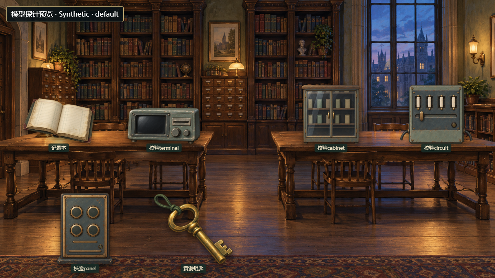
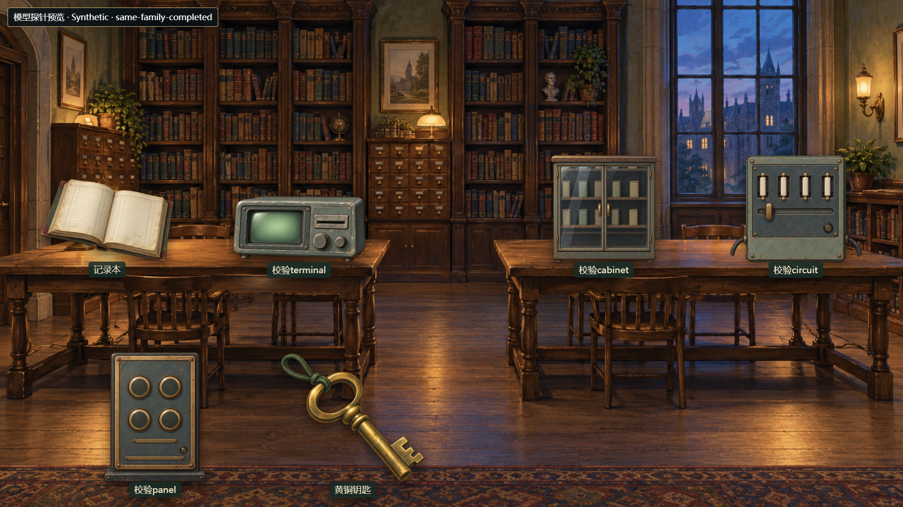

# V5 主题变体 QA

## 执行结果

- **一次 V5 build**：在 `frontend` 执行 `npm run build`，设置 `VITE_GAMEPLAY_VERSION=v5`、`CAMPUS_BACKEND_URL=http://127.0.0.1:8001`，退出码 0。[构建日志](../automated/build-2026-10-30T05-43-52-429Z-5d393833/npm-build.log)与[结果](../automated/build-2026-10-30T05-43-52-429Z-5d393833/result.json)已复制到固定阶段入口；原始日志仍保留在 `frontend/evidence/project/stages/v5-theme-variation/automated/build-2026-10-30T05-43-52-429Z-5d393833/`。仓库没有 `build:v5` 脚本，所以使用现存 `build` 并通过环境变量选择 V5。Vite 提示 Phaser chunk 为 1,388.18 kB，构建成功。
- **一次集中 QA**：`THEME_VARIATION_FORMAL=1; PYTHONUTF8=1; PYTHONDONTWRITEBYTECODE=1; node tests/v5/run_theme_variation_browser.mjs`，退出码 0，194/194 条记录通过。[完整结果与截图目录](../automated/qa-2026-10-30T05-44-19-562Z-49c3ea93/)。自建 8002 Synthetic 服务已停止，外部请求 0，玩家数据库访问 false，真实模型/付费调用 0。
- **静态素材**：五主题共 31 个新图源（15 个背景、16 个物件），像素尺寸、alpha、物件 bbox、manifest 路径及统一 `available_from=2026-10-30T04:44:56.276Z` 均通过。15 个背景候选的槽位布局按底部锚点和热点区域检查；未把 `slot.y` 错当图像上沿。
- **场景模型矩阵**：五主题各取 64 个 Synthetic ID、三种房间类型。每主题观察到 8 种三房背景向量；四类设备均覆盖多个 family，default/completed 保持同 family，额外预载只含所选 family 的另一状态。Python `utc_now` 的 6 位微秒 `Z` / `+00:00` 与精确 cutoff 样例、缺失/非法日期回退、未来候选追加不改变旧关卡选择，以及五份旧 manifest snapshot 的图像/槽位兼容检查均通过。向量数量是有限样例观察，不表示随机性保证。
- **实际浏览器**：一个隔离 Synthetic 图书馆样例任务通过公开 job 状态查询 ready 后点击现有“刷新列表”进入；纹理加载完成、missing=0，1280×720 与 1920×1080 下显示稳定，重载后的选择一致。UI 当前样本选中图书馆 logbook-B、封存资料-B、terminal-B；其随机背景仍为原 `neutral_lab`。新背景及 terminal-B 同 family 完成态通过实际 manifest 选择器生成的明确标注 Synthetic 模型探针预览加载，并有初始/完成截图。它是模型探针图，不冒充游戏内完成态截图。
- **图集**：本地 HTTP 图集显示 86 个图像元素、74 个唯一来源，全部加载且 31 个新增来源齐全；新背景、terminal default/completed 各有单独截图。根目录 `美术图集.html` 以 `file://` 自动跳转至本地 canonical 图集，86/86 加载、74 个唯一来源，HTTP/API/POST 请求均为 0。

## 保留的检查器计数字段问题

原始 QA 结果中 `selected_new_source_count` 记录为 0，原因是检查器把 DOM variant ID 直接与图片 src 比较；这个字段不参与通过断言，原结果保持不变。随后只读用同一浏览器结果中的 variant ID 对照 manifest，确认实际 UI 有 3 个新物件来源（logbook-B、sealed-B、terminal-B）。[派生映射记录](../automated/mapping-2026-10-30T05-46-07-766Z-8f266a12/result.json)保存了更正计数；没有重跑 build 或浏览器。检查入口已窄修该计数映射，正式结果仍按原始执行记录描述。

## 真人检查入口

可以双击根目录 [美术图集.html](../../../../../美术图集.html) 离线查看整批素材；也可打开 `http://127.0.0.1:8001/art-themes/campus-theme-library.html` 查看本地服务图集。重点看五主题背景变化、共享物件配对，以及terminal初始/完成素材是否像同一设备。自动截图只用于技术证据，当前阶段仍待本人检查。

